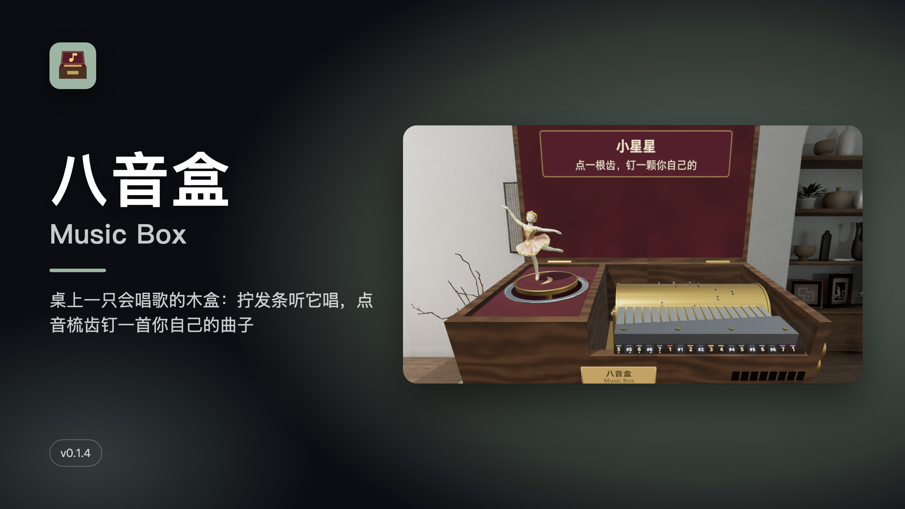
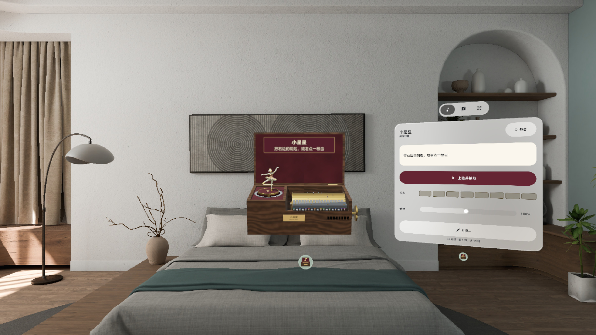
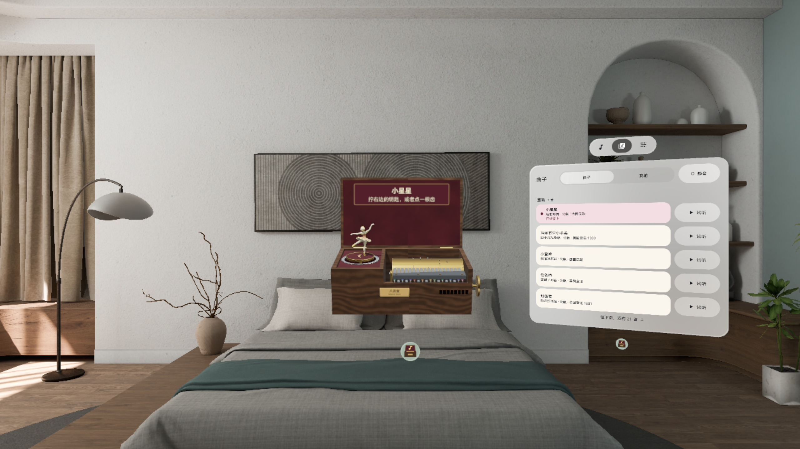
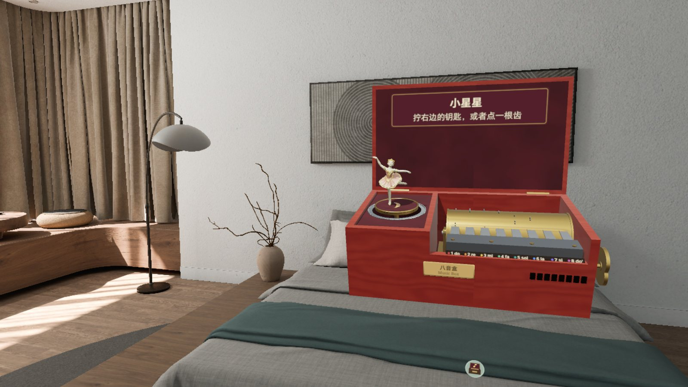
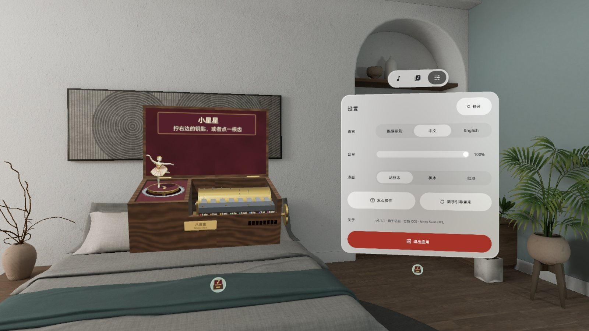
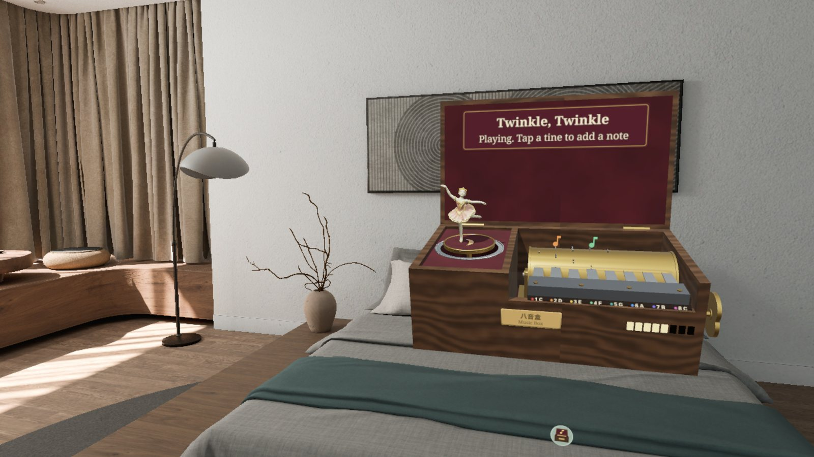
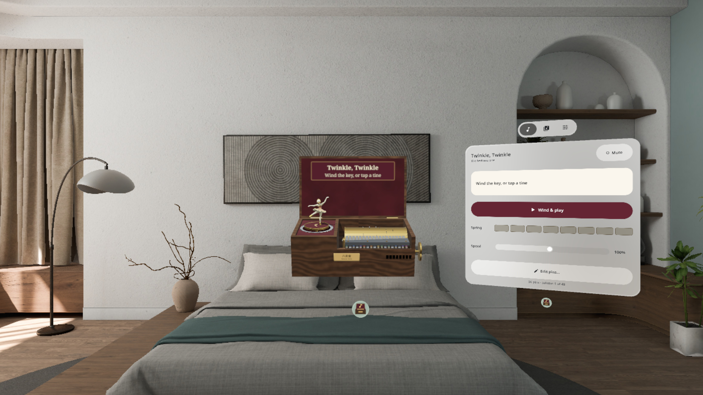
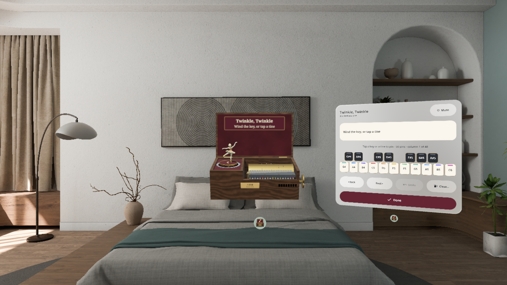
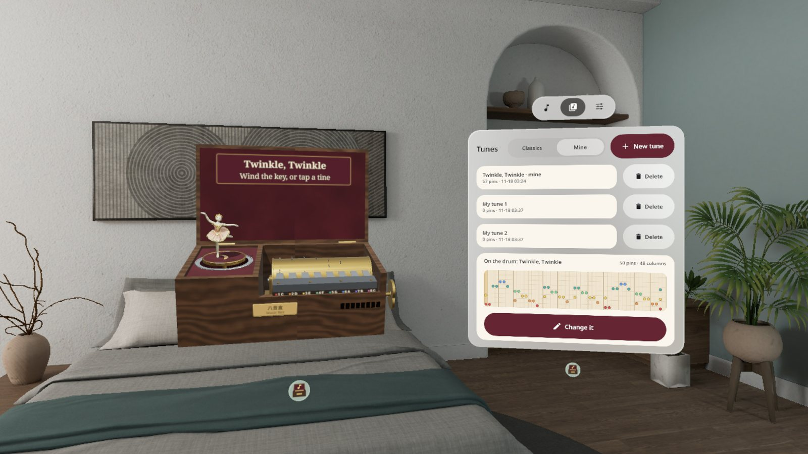
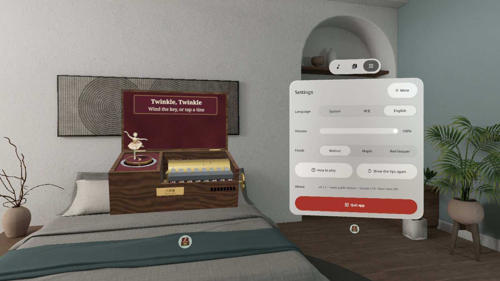

# 八音盒 Music Box



[中文](#中文) · [English](#english)

## 中文

桌上一只会唱歌的木盒。拧发条它就唱，舞者跟着滚筒转；点一根音梳齿，就往滚筒上钉一颗钉——钉一首你自己的曲子，再拧发条听它唱回来。

- **开盖**：盒盖内的曲名卡告诉你现在唱哪首，舞者从井口升起
- **拧发条**：钥匙下 8 格余量，唱着唱着减少，最后渐慢停下；也可以按 [上弦并播放]
- **拨滚筒**：用手前后转，一格一格出声
- **钉谱**：点齿就在当前列钉一颗，播放中也能边听边钉；退一拍、空一拍、撤销 50 步
- **曲子**：17 首公有领域曲，分 童谣 / 民歌 / 古典 / 节日 四组，每行可 [试听]；另有最多 6 首自己的，本机保存
- **木色**：胡桃木 / 枫木 / 红漆；快慢 50%–150%；静音常显
- **声音**：真实八音盒单音的 CC0 录音，按 C 大调变调；节拍按真实时钟走，掉帧也不慢
- 木盒在系统的立体窗口（Shared Space 体积）里，可拖动；控制窗用原生页签：播放 / 曲子 / 设置
- 手势捏合 / 眼动 + 捏合 / 手柄射线；中英双语；全部本机运行，不联网、不需要账号

| | |
|---|---|
|  小星星正在唱，舞者跟着滚筒转 |  播放页：发条余量、快慢、[钉谱…] |
|  钉谱屏：点齿钉音，[钉好了] 回播放 |  曲子：17 首公有领域曲，分组可滑、每行试听 |
|  我的曲子：滚筒上的曲子卡 + 小卷谱 |  红漆木盒 |
|  设置：语言、音量、木色，关于 · v0.1.1 | |

> 截图和演示视频都在 PICO 模拟器里拍（v0.1.1），3D 操作用调试广播驱动（Mac 模拟器发不出 3D 捏合 / 拖动），**非真实手势录像**。演示视频**没有声音**（模拟器录屏不录音）——八音盒以声音为主，请在真机上听。

### 安装

从 [Releases](https://github.com/kejing-dev/MusicBox/releases) 下载 `MusicBox-v0.1.1.apk`（assembleRelease **未签名**包，供商店重签名，不能直接 adb install）。自己装到头显请用 debug 构建：

```bash
export JAVA_HOME=~/.pico/primer-cli/jdk/jdk-21.0.13+9/Contents/Home
./gradlew assembleDebug
adb install -r app/build/outputs/apk/debug/app-debug.apk
pico-cli app launch io.embodit.musicbox
```

需要 PICO OS 6（Android 15，minSdk 35），Spatial SDK 6.1.9。

### 已知问题（v0.1.1）

- 钉谱屏收起 TabBar（专注模式，[钉好了] 回播放页）；从钉谱屏 [清空…] 进的确认页又显示 TabBar
- 「曲子 · 我的」页头没有静音键（播放页、设置等都有）
- 一首唱完后进钉谱屏，读数写「第 49 列，共 48 列」（光标在末尾追加位，逻辑对、文案别扭）
- 播放中进钉谱屏只有灰键和「停下再改」，屏上没有停止键，要先 [钉好了] 再 [停]
- 手柄射线 / 手势射线 / 眼手三种输入点盒盖、齿、钥匙、铭牌和拖钥匙 / 滚筒，还没在真机上逐项验证

### 素材与致谢

齿音：freesound pack 4540（folkman，CC0）；上弦声：freesound 760760（wolfmagpie，CC0）；盒盖声：Kenney（CC0）；舞者：Tripo 生成模型；字体 Noto Sans（SIL OFL）；曲目均为公有领域。构建方法和调试广播见 [AGENTS.md](AGENTS.md)，更新记录见 [CHANGELOG.md](CHANGELOG.md)。

## English

A wooden music box that sings on your desk, for PICO OS 6 Shared Space. Wind it and it plays while the dancer turns with the drum. Tap a tine and a pin lands on the drum, so you can pin a tune of your own and wind it to hear it sung back.

- **Lid**: the card inside names the tune; the dancer rises from her well
- **Wind**: 8 cells of spring under the key run down as it plays, then it slows and stops; or press [Wind & play]
- **Drum**: turn it by hand, note by note
- **Pin a tune**: tap a tine to pin the current column, even while it plays; back, rest, 50-step undo
- **Tunes**: 17 public-domain tunes in four groups (Kids, Folk, Classical, Holiday), each with [Listen], plus up to six of your own, saved on device
- **Finish**: walnut / maple / red lacquer; speed 50–150 %; mute always on screen
- **Sound**: real CC0 recordings of a music box, tuned to C major; timing follows the real clock, so dropped frames don't slow the tune
- The box lives in a system volume you can move; the control window uses the native TabBar: Play / Tunes / Settings
- Gaze + pinch, hand ray or controller; Chinese / English; fully offline, no account

| | |
|---|---|
|  Twinkle, Twinkle playing |  Play: spring gauge, speed, [Edit pins…] |
|  Edit view: tap a tine to pin, [Done] |  Six public-domain tunes |
|  Mine: the tune on the drum + mini roll |  Red lacquer |
|  Settings, About · v0.1.1 | |

> Screenshots and the demo video were taken on the PICO emulator (v0.1.1) with 3D actions driven by the debug broadcast (the Mac emulator can't inject 3D pinch / drag): **not a real-hand recording**. The demo video **has no sound** (emulator screen recording has no audio); listen on a headset.

### Install

Download `MusicBox-v0.1.1.apk` from [Releases](https://github.com/kejing-dev/MusicBox/releases) (assembleRelease, **unsigned**, for store re-signing; it can't be adb-installed as is). To try it on a headset, use a debug build:

```bash
export JAVA_HOME=~/.pico/primer-cli/jdk/jdk-21.0.13+9/Contents/Home
./gradlew assembleDebug
adb install -r app/build/outputs/apk/debug/app-debug.apk
pico-cli app launch io.embodit.musicbox
```

Needs PICO OS 6 (Android 15, minSdk 35), Spatial SDK 6.1.9.

### Known issues (v0.1.1)

- The pin-edit view hides the TabBar (focus mode, [Done] goes back); the confirm page opened from its [Clear…] shows it again
- Tunes › Mine has no mute button in its header (Play, Settings and the others do)
- After a tune ends, the edit view reads "column 49 of 48" (the cursor sits on the append slot)
- While playing, the edit view shows only greyed keys and "stop first", with no stop button there
- The three inputs (controller ray, hand ray, gaze + pinch) on the lid, tines, key, nameplate and the key / drum drags are not yet checked on a headset

### Credits

Tines: freesound pack 4540 (folkman, CC0); winding: freesound 760760 (wolfmagpie, CC0); lid taps: Kenney (CC0); dancer: a Tripo-generated model; font Noto Sans (SIL OFL); all tunes are public domain. Build and debug broadcast: [AGENTS.md](AGENTS.md); history: [CHANGELOG.md](CHANGELOG.md).
